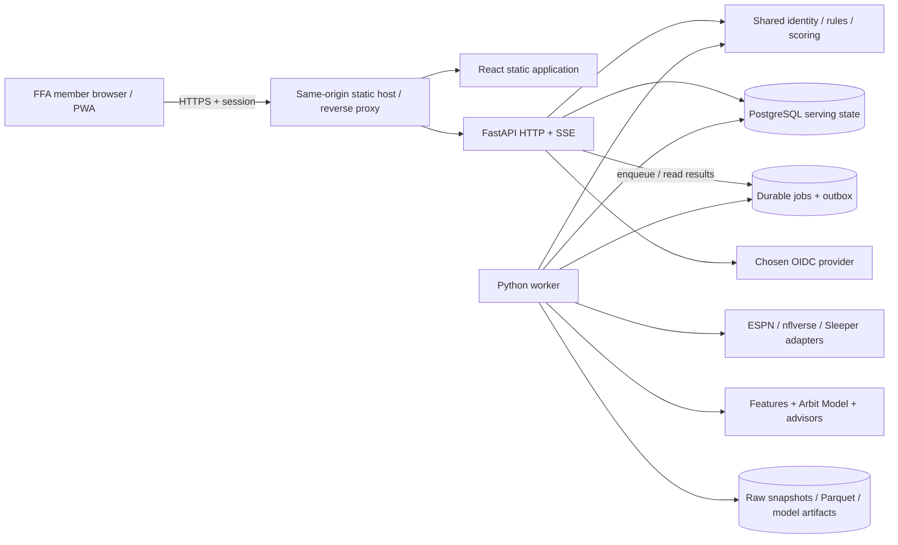

# Arbit Architecture Specification

Version 0.1 · 2026-10-30 · **Proposed, not yet adopted as runtime implementation.**

## Decisions and rationale

Use a mixed-language monorepo with one modular Python backend deployed as API and worker processes, one TypeScript client, PostgreSQL, and file/object storage. This separates long analytical jobs from request handling without introducing independently versioned microservices for a family league. Portable local-first operation is owner-confirmed. No paid service or deployment is provisioned.

| Concern | Proposed choice | Why and alternative considered |
| --- | --- | --- |
| Client | React, TypeScript, Vite, React Router, TanStack Query | Rich tables and interactive research with static delivery. A Next.js/full-stack framework is viable but would add another backend surface alongside Python; public SEO/SSR is not required. React generally recommends a framework; choosing a client SPA means deliberately owning routing, caching, error boundaries, and deployment. [React guidance](https://react.dev/learn/creating-a-react-app), [Vite](https://vite.dev/guide/) |
| UI | Semantic HTML, CSS variables from shared tokens, accessible primitives, SVG + D3 utilities for custom charts/field | Precise statistical and play views; prefer native elements before adding a library. Canvas/WebGL only if measured SVG performance requires it |
| Backend | Python 3.12 baseline, FastAPI, Pydantic, SQLAlchemy, Alembic, HTTPX | Statistical ecosystem and provider adapters stay in one language; OpenAPI-derived client avoids duplicate wire types. A TypeScript API plus separate Python service increases boundaries early. [FastAPI](https://fastapi.tiangolo.com/features/) |
| Transactions | PostgreSQL 18 target, subject to host compatibility validation | Snapshot consistency, transactions, JSONB for raw rule metadata, relational history; SQLite is convenient for throwaway experiments but not the target concurrency and job semantics |
| Analytics | nflreadpy, Polars, DuckDB, Parquet, NumPy/scikit-learn; optional model registry later | nflverse-native foundation with reproducible columnar processing. PostgreSQL holds serving results, not every raw PBP row. [nflreadpy](https://nflreadpy.nflverse.com/), [DuckDB Parquet](https://duckdb.org/docs/2.0/data/parquet/overview) |
| Jobs | PostgreSQL durable jobs, row claiming, leases, retries, scheduled single leader | Avoid Redis/Celery operations initially; explicit idempotency and leases still required. Add a broker only for demonstrated throughput needs. [PostgreSQL locking](https://www.postgresql.org/docs/current/explicit-locking.html) |
| Live delivery | Server-sent events over same-origin HTTP; polling fallback | Predominantly server-to-client updates, reconnect cursor; WebSockets only if future bidirectional interaction warrants them. [SSE](https://developer.mozilla.org/en-US/docs/Web/API/Server-sent_events/Using_server-sent_events) |
| Authentication | Invite-only OIDC with maintained server library; opaque database-backed sessions | No custom password lifecycle; owner chooses an identity provider before auth implementation. ESPN cookies never authenticate Arbit members |
| Tooling | pnpm workspace for JS packages; uv workspace for Python; Make as optional task entry | Separate native lockfiles; no Nx/Turborepo until the dependency graph justifies an orchestrator |
| Deployment | Containers for API/worker; static web behind same-origin reverse proxy; PostgreSQL + storage volume locally, S3-compatible storage remotely | Can start on one host; managed DB/object storage optional. Kubernetes unnecessary at this scale |

Version policy: Node 24 LTS target, Python 3.12 baseline, PostgreSQL 18 target; verify compatibility/security status at M1. Record exact tool versions, lockfiles, and image digests in runtime bootstrap; do not use floating `latest`. Local detected runtimes are not the selected reproducible environment. [Node lifecycle](https://nodejs.org/en/about/previous-releases).

## Component and trust boundaries

Providers are called by the worker, never from the browser. The API validates authorization before loading data, owns user preferences and scenario requests, and serves precomputed results. API and worker import core/data/model libraries using a single dependency direction: core → no adapter imports; data → core; model → core and normalized data interfaces; services compose them. The UI consumes generated API contracts and design tokens, never provider-specific schemas. No module owns a second scoring implementation.

## Repository responsibilities

`apps/web` contains feature routes/components for Front Office, Draft, Scout, Market, Lineup, Live, Archive, and optional model diagnostics. `services/api` contains authentication, request schemas, authorization, feature composition, SSE, and health endpoints. `services/worker` contains scheduling and job dispatch. `libs/arbit-core` owns season/team/player identities, scoring, eligibility and roster constraints. `libs/arbit-data` owns provider adapters, identity reconciliation, snapshots and dataset manifests. `libs/arbit-model` owns point-in-time features, projection distributions, evaluation, archetypes and advisor policy functions. See [repository guide](../engineering/repository-guide.md).

## Request and compute paths

A read pins one published league snapshot, rules hash, data cutoff, and model run. The API retrieves normalized serving views and recommendations matching those versions; a recent roster revision invalidates prior advice. Scenario POSTs validate input against the same snapshot and create idempotent jobs. A quick cached scenario may return synchronously; expensive simulation returns 202 with a job URL and progress events. CPU-bound fitting, large joins, and bulk downloads run only in workers.

Ingestion stores sanitized source objects plus metadata, validates, normalizes, reconciles, and publishes transactionally. One incomplete ESPN response cannot replace an otherwise complete current snapshot. A transactional outbox connects published changes to SSE and recomputation. Consumers are at-least-once and deduplicate; no claim of exactly-once external delivery.

## Authentication and private league access

Invite redemption and OIDC callback require verified issuer/audience/signature, state, nonce, exact redirect URI, and PKCE where supported. Bind issuer + subject to an invited account; email is not the immutable identity. Administrator explicitly binds the account to one or more FFA manager/team memberships. Never offer unrestricted self-selection of another manager's team.

Use random opaque session IDs; store their hashes server-side; rotate after sign-in or privilege changes. Cookies are Secure, HttpOnly, SameSite=Lax, scoped to the application host. Proposed idle expiry seven days and absolute expiry thirty days; administrator can revoke sessions. Same-origin mutating endpoints require CSRF token and origin checks. Apply authorization to API, jobs, exports, and SSE subscriptions. Local development bypasses, if introduced, must refuse production startup.

ESPN access uses a commissioner-provided server-side credential reference if the league is private; the sync credential is a separate trust boundary from user login. Cookies and raw auth headers never enter the client, Git, data snapshots, analytics artifacts, or logs. Secret rotation is an operational action with a recorded check, not a new login method. See [security and operations](../engineering/security-and-operations.md).

## Live and PWA behavior

One backend poll per source/event is shared by all members. Persist provider event identity plus revisions, project scores and timeline views, and publish an outbox record. SSE sends monotonically ordered local event IDs; clients reconnect with `Last-Event-ID`, replay retained events, and request a fresh snapshot if the cursor expired. Heartbeat every 20 seconds; proxy buffering disabled and idle timeout configured. Fall back to a 30-second API poll with a disconnected indicator. Browser event streams use the same session cookie; no credential in URLs.

The PWA manifest, icons, service-worker lifecycle, offline navigation and update banner are implemented at M2. Cache versioned static assets; route `/api`, `/auth`, private exports and SSE network-only. Private response headers use `Cache-Control: no-store`. Authenticated data stays in memory in the first version and is cleared on logout/session expiry; any later offline private data requires an explicit product design. Offline shows shell plus connection status, not current roster or actionable live advice. [Service-worker reference](https://web.dev/learn/pwa/service-workers).

## Reliability, environments, and deployment

Local runtime: web dev server, API, worker, PostgreSQL, local object directory; same-origin proxy preserves cookie behavior. CI uses deterministic sanitized fixtures and ephemeral PostgreSQL, not private ESPN credentials. Staging uses isolated storage/secrets and labeled fixtures or an explicitly configured league snapshot; production has its own volumes, secrets and backups. Runtime process boot validates all settings and refuses missing league/season and unsafe production auth settings.

Proposed scale budget is 25 active sessions, up to 16 concurrently tracked NFL games, and one FFA league. Load test full slate SSE reconnections and model jobs together; maintain read API p95 ≤500 ms from published results. Measure cold loads separately. Source polling budgets and data freshness thresholds are in [data architecture](data-architecture.md); internal delivery target is p95 ≤5 seconds after a normalized event is committed, not five seconds from the play on the field.

Release sequence: CI checks and reviewed migration → backup and restore readiness → build pinned images/static assets → migrate with backward-compatible expand/contract changes → deploy API and worker → health/synthetic-member checks → enable client bundle. Roll back application images; use forward corrective DB migrations unless a tested safe reverse exists. Proposed RPO 24 hours for backed-up league/user data; RTO four hours on an available host. Re-downloadable statistics have lower backup priority; snapshots, mappings, rule versions, account bindings and archive finals are not disposable.

## Alternatives and deferred decisions

A fully managed all-TypeScript platform simplifies web deployment but does not remove the Python analysis workload. A server-rendered React framework is reasonable if public pages become a requirement. A separate analytics microservice, Redis, Kafka, vector DB, GPU stack, and Kubernetes add no demonstrated benefit now. No LLM is necessary for evidence explanations; deterministic templates bind copy to actual metrics. If introduced later, generated prose may not fabricate facts or replace model evaluation.

Owner decisions still needed at the relevant milestone: OIDC provider, hosting capacity/budget, asset links/permission, and whether ESPN league data needs private credentials. Acceptance of this proposal is recorded explicitly in the [decision register](../project/decision-register.md); unresolved source access does not prevent local architecture and contract work.
