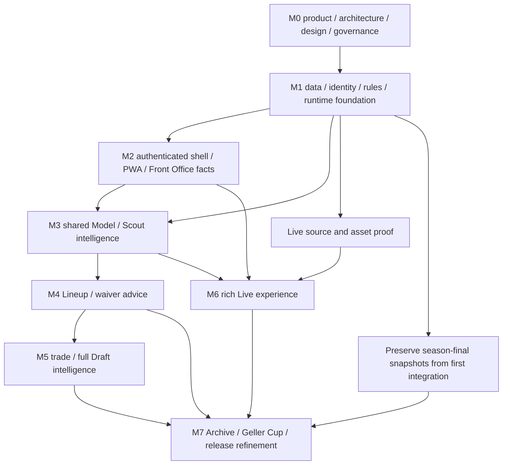

# Arbit Implementation Roadmap

Version 0.1 · 2026-10-30. Dependency plan, not a promised calendar. All 57 obligations are mapped in the [requirement registry](../product/requirements.md). A phase is complete only with its evidence gate; the full scope remains required even when an earlier slice is useful.

## Dependency graph

Provider/asset research can proceed before feature implementation. Archive UI comes late, but historical snapshot preservation starts immediately. The 2026 owner context does not imply any particular NFL week or draft state; use provider data.

## M0 — Product and engineering foundation

**Outputs:** preserved owner brief; product/feature requirements; architecture/data/API/model/design specs; proposed ADRs and source research; cross-agent governance; structured directories; local foundation validation and CI; roadmap and first implementation plan.

**Gate:** all seven initial deliverables linked; all original sections traced; configuration reflects confirmed league/season/local-first preference; internal links and artifact validation pass; independent builder check issues addressed; unresolved provider/auth/asset/hosting decisions explicitly recorded. Owner approved the runtime architecture/stack on 2026-10-30; implementation proceeds through the later gates. No runtime readiness or integration claim follows from this gate.

## M1 — Runtime, data integration, identity and scoring

**Depends on:** M0 artifacts and recorded adoption of architecture choices before framework installation.

**Slices:**

1. M1a: establish pinned Python/pnpm workspace versions and real check commands; ephemeral/local PostgreSQL; core configuration, canonical contracts, exact scoring and eligibility; first health path and job/store contracts. Detailed tasks: [data-foundation implementation plan](../superpowers/plans/2026-10-30-data-foundation.md).
2. M1b: FFA access proof and sanitized contract fixtures; complete settings/team/manager/roster/matchup/standings/draft/availability inventory; pagination and capabilities; private credentials supplied only through a local secure setup if required. The 81-probe public audit verified core reads without cookies; message boards are outside scope. The typed public reader is the next implementation slice.
3. M1c: ESPN stat-category/slot mapping and score reconciliation; canonical cross-provider IDs with ambiguity queue; transactional snapshot publication, source health, durable jobs, backoff, leases and outbox.
4. M1d: nflverse historical and 2026 coverage inventory, dataset manifests and reproducible Parquet ingest; point-in-time feature prerequisites. Record source-specific attribution/terms and actual publication/coverage.
5. M1e: Sleeper documented endpoints and optional scoring/play candidates; ESPN live scoreboard/summary coverage matrix and representative play fixtures; identify exact Gridiron links/variants and reuse prerequisites. Unsupported capabilities stay visible.

**Evidence:** complete FFA snapshot with actual rule support report; core scoring fixtures and matched ESPN totals for supported cases; no ownership/alias collisions; duplicate ingestion is idempotent; 401/429/drift/partial-page fixtures preserve the last valid snapshot; checksum/versioned nflverse sample reload reproduces; secrets absent from Git/logs/artifacts. At least one end-to-end bounded ingest→publish→read path runs locally.

**Blockers:** public FFA access is verified; actual scoring normalization, canonical mappings and durable production sync remain required. Unknown Gridiron URL patterns block exact asset integration only. A missing/unsupported scoring category blocks the corresponding advice, not discovery of that limitation.

## M2 — Authenticated application foundation and Front Office facts

**Depends on:** published league contracts/current snapshots, exact rules, runtime checks; OIDC provider choice before auth implementation.

**Slices:** invite/OIDC/session/team binding; same-origin API/client generation; semantic component primitives and tokens; navigation/player drawer; Front Office team/roster/matchup/standings; period and filter routing; watchlist/preferences; manifest/install/service-worker/update/offline flows; safe degraded-source states. Front Office recommendations show pending analysis until shared Model results exist.

**Evidence:** two distinct manager fixtures and co-manager binding; authorization across API/jobs/SSE; OIDC/CSRF/session-expiry/revocation negatives; desktop and 320 px keyboard/reflow journeys; private-cache exclusion; installation/offline/update smoke check on agreed browsers; measured read-path performance. No product claims depend on fake projections.

## M3 — Shared Model and comprehensive Scout

**Depends on:** M1 normalized data, M2 authenticated shell.

**Slices:** feature definitions with observation cutoffs and coverage; volume/efficiency baselines and position-aware projections; full distributions/FFA scoring/rankings; temporal validation registry and model release pointer; archetypes; Scout search/profiles/history/game logs/advanced metrics/utilization/depth/news/schedule/benchmarks; two-to-four-player comparisons and charts; shared evidence/recommendation components and methodology view; Front Office insights from shared outputs.

**Evidence:** temporal holdout and baseline/subgroup/calibration report, deterministic reproducibility, no future-published features; core profile/point values consistent with serving evaluation; advanced metric definitions and missingness; accessible chart tables and matching filters. If news/injury/route information lacks a verified source, those obligations remain open and partial coverage is explicit; a profile with missing feeds is not declared the full Scout release.

## M4 — Lineup and waiver intelligence

**Depends on:** M2 team context and M3 player distributions/evidence.

**Slices:** globally legal slot optimizer with locks/byes; individual start/sit comparisons and matchup objective; opponent/defense context; FFA availability and waiver/FAAB/deadline semantics; legal roster-specific add/drop simulation; gain/uncertainty and stale ownership handling; Front Office priority queue.

**Evidence:** optimizer agrees with exhaustive small fixtures; FLEX and locks cannot double-assign; opponent objective explains assumptions/correlations; waiver gains compare actual before/after rosters; live ownership change invalidates saved advice; hand-reviewed examples show evidence beyond reused platform projections. Full recommendation methodology and failure states documented.

## M5 — Trade intelligence and end-to-end Draft

**Depends on:** shared evaluations, legal roster utility and league-wide context from M3/M4.

**Slices:** whole-league positional/bye/depth compatibility; custom/suggested multi-player packages and both teams' legal before/after benefit; feasibility assessment, qualitative until validated acceptance data exists; pre-draft strategies/watchlists/tiering; seeded full-draft simulations and availability scenarios; active draft ingestion/board/correction/manual fallback; dynamic priorities and roster construction at each pick.

**Evidence:** no illegal ownership/package/drop; consistent weekly/rest-of-season horizons; both managers' benefits/risks; no invented acceptance model; complete configured-format draft replay; selected players excluded; dynamic recommendations change with roster/scarcity/byes; availability assumptions/calibration clearly labeled. An ADP source, if used, needs its own source record; model-prior simulated behavior is a labeled fallback.

## M6 — Interactive Live

**Depends on:** M1 live coverage proof, M2 shell/session/SSE, M3 shared scoring/evaluations. Exact Gridiron reuse additionally depends on source links/variant/permission evidence.

**Slices:** shared poll/event normalization, corrected stat projections, persisted outbox and reconnect cursors; scoreboards/game stats/player/PBP views; own-roster/fantasy filters and matchup attribution; field coordinate/orientation model; pass/run/sneak/sack/interception/FG/PAT and other canonical play graphics; verified weekly field/uniform manifests and labeled fallback; reduced motion and replay controls; full-slate performance.

**Evidence:** recorded/sanitized replay for each named play class, no-play/correction/duplicate/out-of-order/turnover/overtime; official-vs-provisional scoring separation; expired reconnect cursor restores from snapshot; 25-session/16-game target load with poll budget; source staleness visible; schematic routes not represented as tracking. Text-only Live can be a slice but does not close field/uniform/animation obligations.

## M7 — Archive, Geller Cup and integrated refinement

**Depends on:** preserved historical snapshots and all main user journeys.

**Slices:** final season outcomes/standings/champions/records; trophy timeline, team-name/year/custody tradition; season/team/player comparisons under original scoring; confirmed finals and auditable correction workflow; accessibility/performance hardening across modules; operational restore/rollback and owner acceptance review.

**Evidence:** inaugural empty history and real finalized season; ties and multiweek playoffs; renamed team/manager continuity; cross-season scoring labels; complete manager journeys across all modules; restore test and migration rollback strategy; measured performance/source freshness; every requirement verified or explicitly open. No claim the complete product is finished while core sources, advanced advisor scope or Live assets remain missing.

## Definition of milestone completion and sequencing

Each slice records requirement IDs, plan/files/interfaces, automated/manual evidence, data provenance, limitations, adoption decisions and handoff. No dates or budget estimates are fabricated. Reorder later slices for a real league need, but preserve dependencies and update the registry. New execution plans are written per vertical slice before its code changes; this roadmap is not a substitute for tested interfaces. Owner authorization governs publication/spending; local preparation remains independent.
